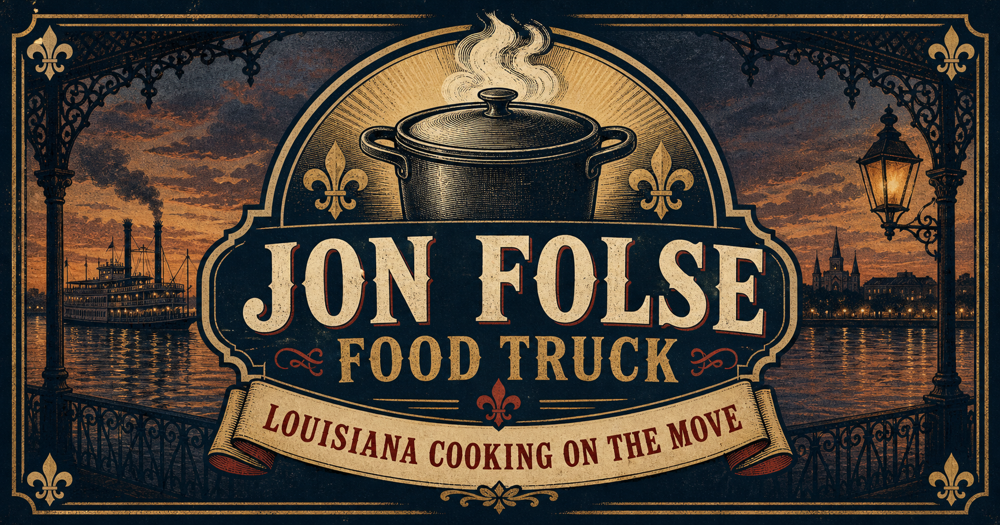

# Jon Folse Food Truck

Louisiana cooking on the move. A responsive food truck and catering site serving Gonzales, Baton Rouge, New Orleans, and communities across South Louisiana.

[Visit the live site](https://jon-folse-food-truck.jon-folse-tech.chatgpt.site)



## Highlights

- Responsive layout with mobile navigation
- Menu, story, catering, schedule, service area, gallery, and contact sections
- Accessible landmarks, keyboard focus states, and reduced-motion support
- Search metadata and structured local-business data
- Cloudflare Workers-compatible build

## Run locally

Requirements: Node.js 22.13 or newer and pnpm 11.19.

```bash
git clone https://github.com/jonfolsetech-ctrl/Jon_Folse_Food_truck.git
cd Jon_Folse_Food_truck/jon-folse-food-truck
pnpm install --frozen-lockfile
pnpm run dev
```

Open the local URL printed by the dev server. Run `pnpm run check` for lint, typecheck, build, and rendered-HTML tests.

See [the app README](jon-folse-food-truck/README.md) for project details, deployment notes, content placeholders, and brand/legal guidance.